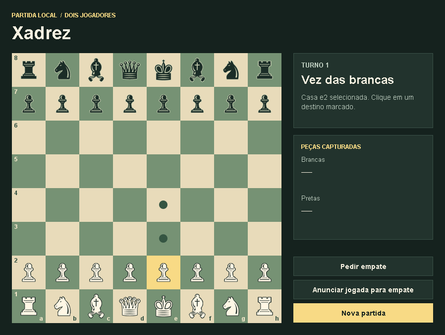

# Xadrez em Java

Jogo de xadrez para duas pessoas no mesmo computador, com uma interface gráfica em Swing e um modo terminal. A partida funciona offline e o aplicativo recebe apenas comandos do jogo.



## Como jogar no Windows

1. Instale o **JDK 21 ou superior**.
2. Clone o repositório ou use **Code → Download ZIP** no GitHub e extraia a pasta.
3. Abra `abrir-xadrez.cmd`. O inicializador compila o código localmente e abre a janela do jogo.

Clique em uma peça da cor que está jogando e, em seguida, em um destino destacado. Para o roque, selecione o rei e a casa de destino. A interface mostra o turno, as peças capturadas, o xeque e o resultado da partida.

## Modo terminal

No PowerShell, execute os comandos abaixo na pasta do projeto, com o JDK no `PATH`.

```powershell
New-Item -ItemType Directory -Force bin | Out-Null
$fontes = Get-ChildItem src -Recurse -Filter *.java | Select-Object -ExpandProperty FullName
javac --release 21 -encoding UTF-8 -d bin $fontes
java -cp bin application.Program
```

Digite a origem e o destino em linhas separadas, como `e2` e `e4`. O comando `empate` solicita empate pela posição atual. Para indicar uma jogada que completaria a condição, use `empate ORIGEM DESTINO`.

## Créditos

Projeto de estudo desenvolvido a partir da sequência de aulas de xadrez do curso **Java COMPLETO – Programação Orientada a Objetos + Projetos**, de Nélio Alves. A janela Swing e as regras de empate são extensões desta versão. [Projeto de referência do curso](https://github.com/acenelio/chess-system-java)
